# Mark Lee

Systems & platform engineer. By day: infrastructure on the team supporting 2,000+ users
across 20 sites. Beside it: a production-style platform lab with GitOps-run Kubernetes, drilled
restores, an AWS account in Terraform with cost gates, and AI tooling under guardrails.

<picture>
  <source media="(prefers-color-scheme: dark)" srcset="assets/map-dark.svg">
  
</picture>

**Case studies** at [leemark.dev](https://leemark.dev):

- [GitOps Platform](https://leemark.dev/projects/homelab-gitops/): Kubernetes delivery through Git, CI and Argo CD.
- [AI SRE Incident Agent](https://leemark.dev/projects/sre-incident-agent/): investigates cluster alerts without changing the cluster.
- [Golden Deployment Path](https://leemark.dev/projects/golden-path/): reusable templates and checks for shipping services to Kubernetes.
- [AWS Cost & Capability Lab](https://leemark.dev/projects/aws-lab/): every AWS service priced before it's built, proven live before it's trusted.

[Résumé](https://leemark.dev/resume/)
